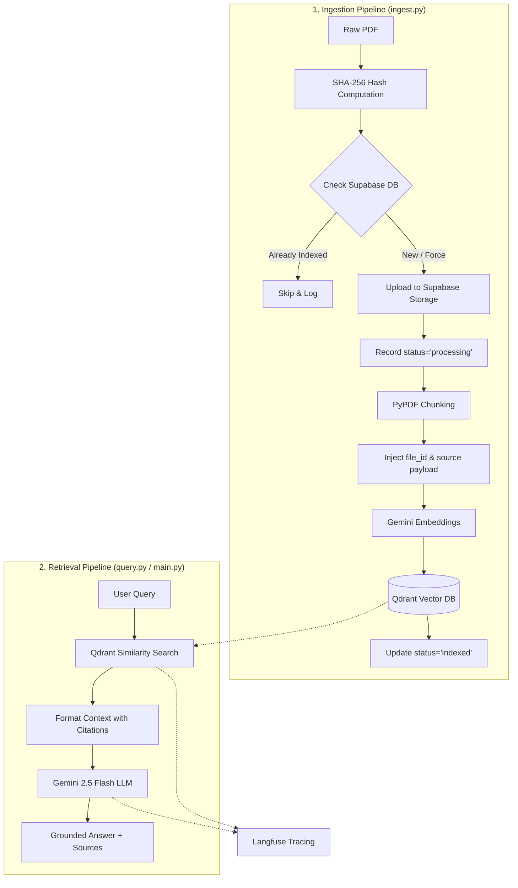

# Academic Research Paper RAG (Decoupled Production Architecture) 📚🤖

A production-grade **Retrieval-Augmented Generation (RAG)** system built from scratch over academic research papers, decoupled into two completely independent services:
1. **Ingestion Pipeline**: Handles document uploading, SHA-256 deduplication, Supabase cloud storage, metadata tracking, chunking, and Qdrant vector indexing.
2. **Retrieval Pipeline**: Independent, lightweight query engine that connects directly to Qdrant, retrieves top-$k$ context with citations, and generates answers via Gemini with full Langfuse observability.

---

## 🏗️ Decoupled Architecture & Tech Stack



### Core Technologies:
- **LLM**: Google Gemini (`gemini-2.5-flash`) via `langchain-google-genai`
- **Embedding Model**: Google Generative AI (`gemini-embedding-001`)
- **Metadata & State Tracking**: **Supabase PostgreSQL** (`documents` table)
- **Raw File Storage**: **Supabase Storage** (Bucket: `research-papers`)
- **Vector Database**: **Qdrant** running locally via Docker (Payload filtered by `file_id`)
- **Observability & Tracing**: **Langfuse**
- **Framework**: LangChain Core & Text Splitters

---

## 📄 Benchmark Research Papers

The pipeline was benchmarked and tested on landmark deep learning papers:

1. **Attention Is All You Need** (Transformer architecture): [arXiv:1706.03762](https://arxiv.org/abs/1706.03762)
2. **LoRA: Low-Rank Adaptation of Large Language Models**: [arXiv:2106.09685](https://arxiv.org/abs/2106.09685)
3. **Batch Normalization: Accelerating Deep Network Training**: [arXiv:1502.03167](https://arxiv.org/abs/1502.03167)
4. **SqueezeNet: AlexNet-level accuracy with 50x fewer parameters**: [arXiv:1603.02754](https://arxiv.org/abs/1603.02754)

---

## 🚀 Getting Started

### 1. Clone the Repository
```bash
git clone https://github.com/marwanemam10/Research-Paper-RAG.git
cd Research-Paper-RAG
```

### 2. Create and Activate Virtual Environment
```bash
python -m venv .venv

# On Windows:
.venv\Scripts\activate

# On Linux/macOS:
source .venv/bin/activate
```

### 3. Install Dependencies
```bash
pip install -r requirements.txt
```

### 4. Configure Environment Variables
Copy `.env.example` to `.env` and fill in your keys:
```bash
cp .env.example .env
```

```env
# Google Gemini API
GEMINI_API_KEY=your_gemini_api_key_here

# Qdrant Vector Database (Local Docker)
QDRANT_URL=http://localhost:6333
QDRANT_API_KEY=your_qdrant_api_key_here

# Supabase (PostgreSQL Metadata & Storage)
SUPABASE_URL=https://your-project.supabase.co
SUPABASE_SERVICE_ROLE_KEY=your_service_role_key_here

# Langfuse Observability
LANGFUSE_PUBLIC_KEY=your_langfuse_public_key_here
LANGFUSE_SECRET_KEY=your_langfuse_secret_key_here
LANGFUSE_BASE_URL=https://cloud.langfuse.com
```

### 5. Setup Databases

#### A. Start Qdrant (Docker)
```bash
cd qdrant-local
docker compose up -d
cd ..
```

#### B. Setup Supabase Tables & Storage
Execute the SQL commands in `supabase_schema.sql` in your **Supabase SQL Editor**:
- Creates the `research-papers` storage bucket.
- Creates the `documents` table with deduplication indexes and status tracking.

---

## ⚡ Running the Decoupled Pipelines

### 📥 1. Ingestion Pipeline (`ingest.py`)
Upload, deduplicate, chunk, and index PDFs:

```bash
# Ingest all PDFs from the default data folder (src/data):
python ingest.py

# Ingest a specific single PDF:
python ingest.py --file src/data/1706.03762v7.pdf

# Ingest an entire custom directory:
python ingest.py --dir /path/to/my/pdfs

# Force re-index even if already indexed in Supabase:
python ingest.py --force
```

### 🔍 2. Retrieval Pipeline (`query.py` or `main.py`)
Pure retrieval and answer generation (starts instantly, never touches PDF files):

```bash
# Interactive CLI chat loop:
python query.py -i

# Single question mode:
python query.py -q "What is LoRA and how does it reduce trainable parameters?"

# Retrieve top 6 chunks for context:
python query.py -q "Explain Batch Normalization" --k 6
```

---

## 🧪 Running Tests

Unit and integration tests are organized under the `tests/` directory:

```bash
# Run all tests
python -m unittest discover tests

# Test Splitting module
python -m unittest tests/test_splitting.py

# Test Supabase utilities & hashing
python -m unittest tests/test_supabase.py

# Test Qdrant Indexing module
python -m unittest tests/test_indexing.py
```
