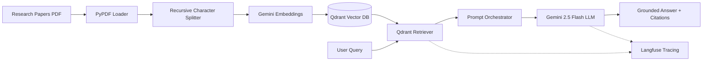

# Academic Research Paper RAG (From Scratch) 📚🤖

A production-ready **Retrieval-Augmented Generation (RAG)** system built from scratch to index, search, and answer complex questions over academic research papers with precise citations and observability.

---

## 🏗️ Architecture & Tech Stack

- **LLM**: Google Gemini (`gemini-2.5-flash`) via `langchain-google-genai`
- **Embedding Model**: Google Generative AI (`gemini-embedding-001`)
- **Vector Database**: **Qdrant** running locally via Docker
- **Framework**: LangChain Core & Text Splitters
- **Observability & Tracing**: **Langfuse** (tracks retrieval latencies, prompts, and tokens)
- **Environment & Secrets**: `python-dotenv`



---

## 📄 Benchmark Research Papers

The pipeline was benchmarked and tested on landmark deep learning papers:

1. **Attention Is All You Need** (Transformer architecture): [arXiv:1706.03762](https://arxiv.org/abs/1706.03762)
2. **LoRA: Low-Rank Adaptation of Large Language Models**: [arXiv:2106.09685](https://arxiv.org/abs/2106.09685)
3. **Batch Normalization: Accelerating Deep Network Training**: [arXiv:1502.03167](https://arxiv.org/abs/1502.03167)
4. **SqueezeNet: AlexNet-level accuracy with 50x fewer parameters**: [arXiv:1603.02754](https://arxiv.org/abs/1603.02754)

> Place your PDF files inside `src/data/`.

---

## 🚀 Getting Started

### 1. Clone the Repository
```bash
git clone https://github.com/marwanemam10/Research-Paper-RAG.git
cd Research-Paper-RAG
```

### 2. Create and Activate Virtual Environment
```bash
python -m venv .venv

# On Windows:
.venv\Scripts\activate

# On Linux/macOS:
source .venv/bin/activate
```

### 3. Install Dependencies
```bash
pip install -r requirements.txt
```

### 4. Configure Environment Variables
Copy `.env.example` to `.env` and fill in your keys:
```bash
cp .env.example .env
```

```env
# Google Gemini API
GEMINI_API_KEY=your_gemini_api_key_here

# Qdrant Vector Database (Local Docker)
QDRANT_URL=http://localhost:6333
QDRANT_API_KEY=your_qdrant_api_key_here

# Langfuse Observability
LANGFUSE_PUBLIC_KEY=your_langfuse_public_key_here
LANGFUSE_SECRET_KEY=your_langfuse_secret_key_here
LANGFUSE_BASE_URL=https://cloud.langfuse.com
```

### 5. Start Qdrant Vector Database
Using Docker Compose:
```bash
cd qdrant-local
docker compose up -d
cd ..
```

---

## ⚡ Running the Pipeline

### Interactive CLI Mode
Ask questions continuously about any research paper in your data directory:
```bash
python pipeline.py -i
```

### Single Query Mode
```bash
python pipeline.py -q "What is the key advantage of the Transformer architecture over recurrent models?"
```

### Re-index PDFs
If you add new PDFs to `src/data/`:
```bash
python pipeline.py --reindex
```

---

## 🧪 Running Tests

Unit and integration tests are organized under the `tests/` directory:

```bash
# Run all tests
python -m unittest discover tests

# Test Splitting module
python -m unittest tests/test_splitting.py

# Test Qdrant Indexing module
python -m unittest tests/test_indexing.py
```
